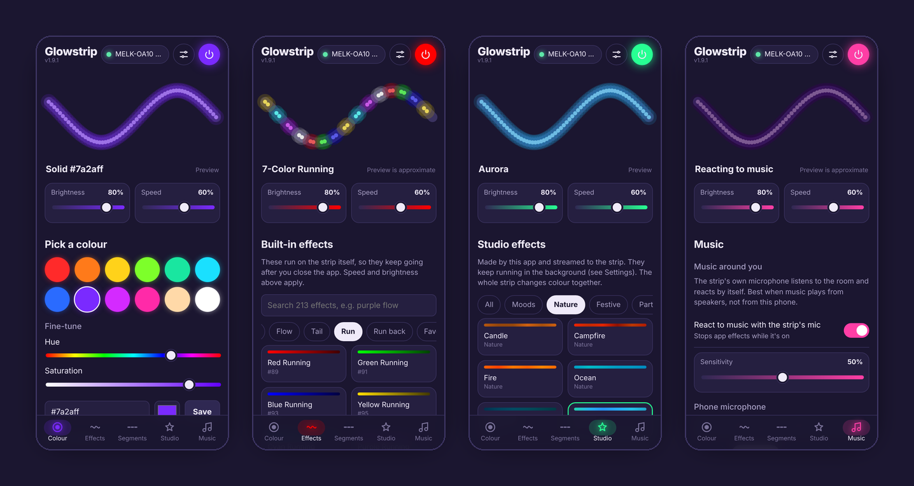
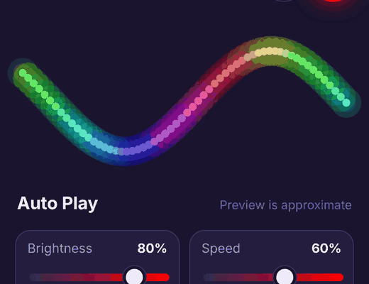
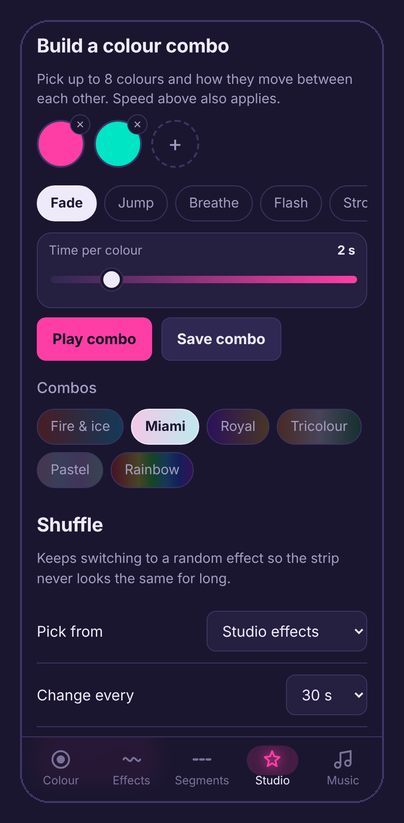
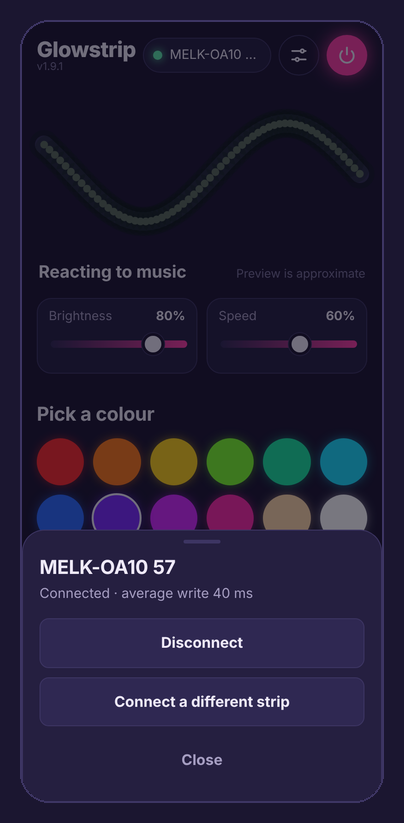
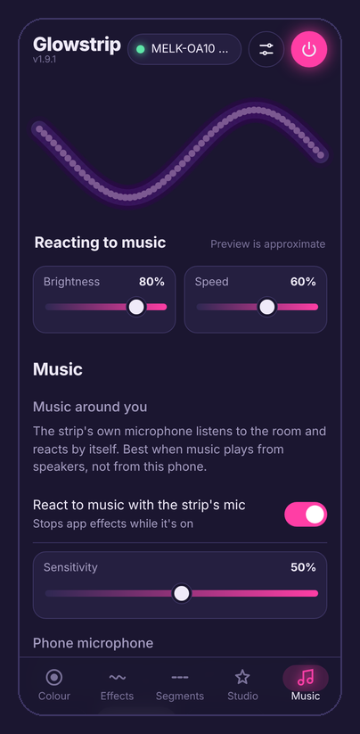
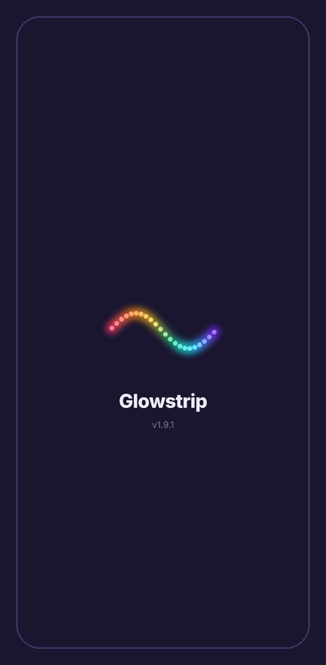
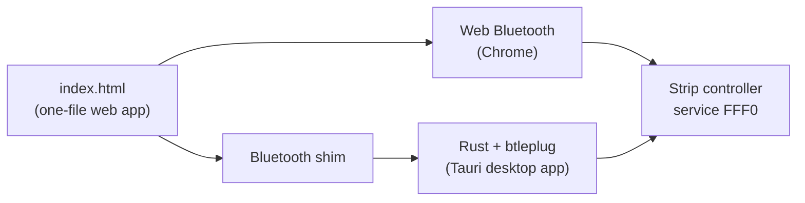

<p align="center">
  
</p>

<h1 align="center">Glowstrip</h1>

<p align="center">
  An open-source controller for the low-cost Bluetooth RGB strips that ship with the<br>
  <b>Lotus Lamp X</b> and <b>Magic Lantern</b> apps. Clean interface, more effects, no account, no ads.
</p>

<p align="center">
  <a href="https://glowstrip.vercel.app"><b>Open the web app</b></a> ·
  <a href="https://github.com/imnakul/Glowstrip-Custom-Webapp-for-RGB-Lights/releases/latest"><b>Download for Windows</b></a> ·
  <a href="#supported-lights">Supported lights</a> ·
  <a href="CHANGELOG.md">Changelog</a>
</p>

<p align="center">
  
</p>

## Why Glowstrip

Strips sold for ₹500–1,000 (and similar elsewhere) usually come with a QR code for a vendor app. Those apps work, but they are cluttered, ask for broad permissions, and hide useful controls. Glowstrip talks to the same controller directly over Bluetooth and gives you:

- a focused interface that works one-handed on a phone
- 42 extra effects made by the app, a colour-combo builder and shuffle
- music sync from the strip's own microphone or your phone's
- automatic reconnect, background running, and an installable app on Android and Windows

Everything runs on your device. There is no server, no login and no analytics.

## Supported lights

Glowstrip currently speaks the **ELK / Lotus Lamp X "SYMPHONY"** protocol (Bluetooth service `FFF0`, write characteristic `FFF3`).

| Controller (name shown in Bluetooth) | App on the box | Status |
|---|---|---|
| `MELK-OA10 …` | Lotus Lamp X, Magic Lantern | **Works.** Used daily; colours, effects, scenes, speed, brightness and the strip's mic |
| Other `MELK-…` / `ELK-…` controllers with service `FFF0` | Lotus Lamp X, Lotus Lantern | **Likely works**, not yet confirmed. Please [report your result](https://github.com/imnakul/Glowstrip-Custom-Webapp-for-RGB-Lights/issues/new?template=controller.yml) |
| `ELK-BLEDOM`, `LED LIGHT STRIP` | duoCo Strip, Lotus Lantern | **Untested.** Similar protocol; may need small changes |
| `TAPE LIGHTS` and other controllers using service `49535343-…` | Rhythm Pro | **Not supported yet.** Different protocol |
| Wi-Fi strips (Tuya / Smart Life, Govee, …) | various | **Not supported** |

**Check your strip in one minute:** install [nRF Connect](https://play.google.com/store/apps/details?id=no.nordicsemi.android.mcp), scan, and look at the name. Connect and check for a service `0xFFF0`. If you see both, Glowstrip should work.

**About segments:** most of these strips are addressable (RGBIC), but the MELK-OA10 firmware has no command for setting individual pixels, so fixed multi-colour layouts are not possible on this controller. The Segments tab is a designer and preview for now. Built-in effects still use the full strip.

## Features

<table>
<tr>
<td width="50%" valign="top">

**Colour**
Swatches, hue and saturation sliders, hex input and saved colours. The app's accent follows the light, so the screen always matches the strip.

**213 built-in effects and 29 scenes**
Every effect from the bundled app, grouped (Curtain, Trans, Water, Flow, Tail, Run…) with search and favourites. These run on the controller, so they continue after you close the app.

**Studio**
42 effects generated by the app: Lava lamp, Aurora, Thunderstorm, Firefly, Diwali diya, Holi, Tricolour, Club pulse at 128 BPM, 4-7-8 breathing, a 15-minute sleep fade, a 10-minute sunrise and more. Build your own combos from up to 8 colours with Fade, Jump, Breathe, Flash, Strobe or Sparkle, or let Shuffle change the effect every few seconds or minutes.

</td>
<td width="50%" valign="top">

</td>
</tr>
<tr>
<td width="50%" valign="top">

</td>
<td width="50%" valign="top">

**Music**
Turn on the strip's own microphone to react to music in the room, with adjustable sensitivity. Or let the phone listen and drive the strip in Pulse, Spectrum or Beat-flash style.

**Connection that stays up**
Auto-connects to your last strip on launch and when you come back to the app, retries quietly if the strip drops, and sends a harmless keep-alive so idle links don't close. Tap the status pill to disconnect, reconnect or switch strips.

**Runs in the background**
App-made effects and music keep running with a media notification you can stop from. Optional keep-screen-on mode for phones that close background apps aggressively.

**Lab**
Send raw bytes to the strip, read replies, and see average Bluetooth write time. Useful for adding new controllers.

</td>
</tr>
</table>

<p align="center">
  
  
  
</p>

## Install

### Android (web app)

1. Open **[glowstrip.vercel.app](https://glowstrip.vercel.app)** in **Chrome**.
2. Tap **Install app** when Chrome offers it, or use ⋮ → **Install app**.
3. Close the Lotus Lamp X / Magic Lantern app first: a strip accepts only one connection at a time.
4. Open Glowstrip, tap **Connect strip** and pick your controller.

Allow **Nearby devices** and **Location** for Chrome if Android asks. For background running on OnePlus, Oppo, Xiaomi or Vivo phones, set both Glowstrip and Chrome to *Always allow* / *Unrestricted* in battery settings.

### Windows (desktop app)

Download the latest `Glowstrip_x.y.z_x64-setup.exe` from [Releases](https://github.com/imnakul/Glowstrip-Custom-Webapp-for-RGB-Lights/releases/latest) and run it. Windows SmartScreen may warn about an unknown publisher because the app isn't code-signed; choose **More info → Run anyway**.

The desktop app uses Windows' own Bluetooth stack through Rust, so it avoids browser Bluetooth quirks and isn't paused in the background. It is new; please report anything that doesn't work.

### Where it runs

| Platform | Status |
|---|---|
| Android, Chrome (web app) | Supported |
| Windows desktop app | Supported (new) |
| Chrome or Edge on Windows, macOS, Linux | Works in the browser; macOS and Linux untested |
| iPhone and iPad | Not possible: iOS browsers don't support Web Bluetooth |
| Firefox, Safari | Not possible: no Web Bluetooth |

## How it works



- The whole interface is a single `index.html` with no build step and no dependencies beyond two Google Fonts.
- In the browser it uses Web Bluetooth. In the desktop app, a small shim maps the same calls to native Rust commands, so both share one codebase.
- Commands are 9-byte frames written to `FFF3`. The format is documented in **[docs/PROTOCOL.md](docs/PROTOCOL.md)**.
- A service worker makes the web app installable and usable offline, and fetches updates on launch.

## Roadmap

These are planned or under investigation, not finished:

- **More controllers:** ELK-BLEDOM confirmation, and the Rhythm Pro (`TAPE LIGHTS`) protocol once someone shares a Bluetooth capture
- **PC lighting sync:** match the strip to MSI Mystic Light and other PC RGB through OpenRGB, in the desktop app
- **Real static segments:** via an ESP32 running WLED for strips whose controller can't address pixels
- **macOS and Linux desktop builds**

## Contributing

Bug reports, controller reports and pull requests are welcome. The most useful contribution is a Bluetooth capture from a strip that isn't supported yet; [CONTRIBUTING.md](CONTRIBUTING.md) explains how to make one in about ten minutes.

Run it locally with any static server; `localhost` counts as a secure context for Web Bluetooth:

```sh
python3 -m http.server 8000      # then open http://localhost:8000 in Chrome
```

Desktop app: `cd desktop && npm install && npx tauri dev`

## Credits

The command set builds on community reverse engineering of the Lotus Lamp X app, in particular [l0lsec/LotusLampX](https://github.com/l0lsec/LotusLampX) and [lotus-lamp](https://pypi.org/project/lotus-lamp/). Desktop Bluetooth uses [btleplug](https://github.com/deviceplug/btleplug); the desktop shell is [Tauri](https://tauri.app).

## Disclaimer

Glowstrip is an independent project. It is not affiliated with or endorsed by the makers of Lotus Lamp X, Lotus Lantern, Magic Lantern, Rhythm Pro, ELK or any strip manufacturer. Product names are used only to describe compatibility.

## License

[MIT](LICENSE)

<sub>Keywords: Lotus Lamp X open-source alternative, LotusLampX, Lotus Lantern app alternative, Magic Lantern app alternative, ELK-BLEDOM, MELK-OA10, Bluetooth LED strip controller, RGBIC neon strip app, Web Bluetooth, PWA, Tauri.</sub>
